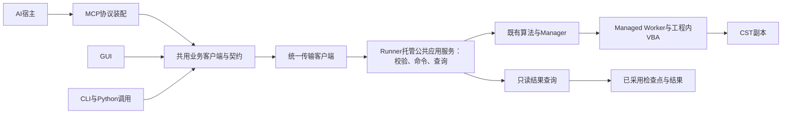

# CST Tools共用底层：MCP优先的静态框架设计

日期：2026-10-28。状态：设计草案，未实现。本文收敛[接入计划](mcp-design-plan.md)的结构；CST语义以[能力/作用域审查](mcp-cst-capability-scope-design.md)为依据，协议以[符合性矩阵](mcp-protocol-conformance.md)为依据。当前优先完成静态设计，不创建服务骨架、添加依赖或启动求解。

## 1. 框架决策

内部快速迭代规则：现代MCP协议与统一底层实现优先，不维护旧API、旧DTO、旧错误格式、旧客户端或旧协议握手。允许破坏性修改；同一批次更新GUI、CLI、测试、文档和打包入口，直接删除被替代路径，不添加deprecated别名、版本分支、兼容代理或双轨框架。14工具是待静态收敛的候选清单，不因已有计划而固定数量/名称。

协议支持核实是标准实施门禁，不是旧兼容工作；目标宿主/SDK不支持所选现代基线时，记录阻塞并更换或升级支持组合，不自动降级。协议优先也不能证明尚未验证的CST能力。

设计顺序确定为：MCP标准约束 → 统一业务契约 → CST Tools公共应用服务 → Runner/计算后端迁移。旧Runner接口是待审查和迁移的实现，不是新契约上限；不能为了沿用旧方法而扭曲协议，也不另建MCP专属业务框架。GUI、CLI、Python调用和MCP共用相同业务校验、命令处理、结果查询与错误定义。

MCP规定消息、工具Schema、结果信封和取消等协议行为；频率窗口、任务身份、采用和安全收尾由项目定义。两者必须明确区分，不能把本项目业务字段称为MCP标准要求。统一业务服务不依赖Qt或MCP SDK，协议装配只做标准映射。CST句柄及VBA由计算后端持有；服务重启不能改变已受理任务身份。

本图描述目标依赖；只读结果查询服务尚未实现。离线inspect是服务中的受限文件读取分支，必须标记offline，不生成虚构Runner状态。

## 2. 最小模块划分

以下新增模块、类及方法均为拟定，不是已存在接口。先采用三个模块，不为每种职责增加一套框架或注册系统。

|模块|职责|允许依赖|禁止承担|
|---|---|---|---|
|mcp_server.py|SDK入口、工具Schema/说明、协议结果封装、stdio与退出管理|官方SDK、公共业务契约/客户端|CST/Qt导入、直接访问模型、业务恢复判断|
|application_service.py（取代原拟定mcp_service.py）|公共业务校验、命令/查询协调、诊断导出与统一错误；由Runner托管，GUI/CLI/MCP同用|公共契约、现有执行/诊断/结果组件|Qt/SDK导入、复制任务调度和采用协议、按日志文本判断成功|
|result_query.py|有限读取、来源/单位/可用性、revision与分页|现有检查点/结果格式、标准库|Qt展示类、SDK、启动Runner/CST、写采用记录|
|现有Runner|控制租约、原子身份前提、命令去重、运行生命周期、托管查询入口|现有后端及result_query|理解MCP消息/宿主对话、持有MCP控制句柄|

优先扩展现有`execution_contract.py`和`RunnerClient`，形成公共业务DTO、错误、客户端及传输接口；有必要时迁移现有定义，不保留重复定义。公共服务由Runner托管，客户端不各自运行一套服务。mcp_server只保存协议请求与业务请求的关联和宿主授权配置，不再拥有独立业务校验、诊断导出或结果状态机。SDK只在显式MCP入口导入，普通GUI/Runner安装不依赖它。

## 3. 内部接口草案

|边界|拟定调用|约束|
|---|---|---|
|GUI/CLI/MCP→公共服务|具名业务操作及统一请求DTO|operation来自静态白名单；request_context仅用于本次协议取消/诊断，不作为业务身份|
|服务→Runner|既有status/events/command_record/command|写命令补充expected_instance_id、必要expected_run_id；Runner在命令锁内验证；不靠先查后写消除竞态|
|服务→控制记录|claim/release/validate handle|句柄绑定项目、实例、独立client_id与期限；不同调用不能共用进程级隐式控制权|
|Runner→查询|read_modes(project, run_id, revision, cursor, limit)|只读已采用结果；游标绑定revision；变更返回RESULT_CHANGED；不借GUI截断视图代替全量数据|
|服务→诊断|现有export_failure_bundle的受控调用|限定输出目录及预算；request_id关联唯一导出事实/工件哈希，不自动上传|

不新增通用反射调用接口。运行控制阶段先提供14个具名操作；完整目标按COMSOL对齐矩阵扩展，工具数不限14，读写前提按各能力子契约定义。无任意函数名、模块名、脚本或执行路径输入。

DTO分为三组：查询快照（来源、revision、业务状态）、命令回执（request_id、accepted/unknown及可查询身份）、工件清单（来源、大小/哈希、available/truncated）。共用错误结构code/phase/action/retryable/error_ref；retryable不等于授权重算。所有结果放入SDK标准信封，不以业务DTO替代协议result。

## 4. 状态与存储权威

|事实|权威位置|适配器记录的用途|
|---|---|---|
|命令是否持久受理|Runner命令记录|保存原client_id、request_id、payload哈希及返回映射，以便原身份查询/重放|
|计算是否活动、项目锁/控制权|Runner和现有所有权实现|只缓存带instance/revision的观察，不把旧缓存当当前授权|
|模式/覆盖是否确认及结果采用|检查点、RunStore和现有采用协议|只查询，不补写确认前沿或伪造完成|
|CST是否安全收尾|Worker收尾评估、v2回执、StopAck、实际进程事实|向外传播各维度，不将FAILED或进程退出等同标准关闭|
|调用者控制句柄与业务重试身份|项目control/mcp专用小记录（拟定）|不是第二个任务库；不复制任务状态机；不复用GUI停止意图文件|

请求本地状态仅为prepared→sent→accepted或unknown；unknown必须查询对账，不自行转回prepared重启求解。accepted之后是否完成由Runner/结果权威回答，不能靠MCP进程内Future判断。

## 5. 并发、取消与资源生命周期

- 每项目写命令沿Runner串行；适配记录仅短时加锁，任何锁不得跨整个CST计算。查询有限并发且有文件/响应预算，不能无限制并发读大场。
- 显式控制句柄到期后停止心跳；MCP退出尽力释放自身控制权并关闭HTTP/日志/文件资源，不停止独立Runner。保留记录供重连对账，不保存Bearer令牌。
- 协议取消只处理当前请求尚可取消的工作；持久受理后的运行独立继续。stop_run另行请求合作停止，Solver内等待不承诺立即中断。
- 连接/通信/查询/退出有界；正常求解无固定总时限。超时只产生unknown/unavailable，不能制造另一个start。
- 旧Runner契约不再适配；新客户端与后台契约不匹配时统一拒绝连接并要求正常停止旧后台、使用同批版本重启，不进行只读兼容降级。不得解析中文异常、枚举全机CST进程或强制释放锁。

## 6. 静态审查清单与冻结条件

实施前先形成以下可审查结果，不通过创建空类/大量mock测试证明设计完成。

- [x] 对照现行Runner/RunnerClient/执行契约/RunStore，确定生命周期所有权及单向依赖。
- [x] 对照安装版CST官方接口，区分3D/DS/子工程、CLI/原生Python、0D/1D/场及历史持久性。
- [x] 收敛为公共应用服务、公共结果查询和MCP协议装配；替代原MCP专属service提案。旧底层按契约需要迁移，不预先冻结Runner接口。
- [x] 已形成14操作字段级静态契约、身份/错误/预算及副作用；见统一契约。算子/优化策略子Schema已在D11冻结，实际运行Schema及算法缺口修复仍pending。
- [x] 已核对命令持久化、控制过期、实例替换、ACK/采用及收尾传播，绑定迁移表中的实际函数及修改落点；不是运行故障验收。
- [x] 已核对当前文件字段，定义哈希revision及待新增run→scan/revision映射；缺历史证据返回不可用，未实施查询。
- [x] 核对官方SDK稳定2.3.0及本机CLI同名tag现代协议支持/开关；见SDK宿主知识库。实际桌面有效配置、SDK安装和wire握手仍pending，不自研双协议栈。
- [ ] 审查AddToHistory返回检查缺口及其独立修复范围；不因设计阶段擅自修改生产逻辑。
- [ ] 完成上述静态审查后，更新设计决定和剩余不确定项，再进入M0契约代码及M1只读实现。

动态测试先设计用例：响应丢失、同ID异内容、并发重复、句柄过期、GUI争用、实例变化、活跃运行取消、结果revision变化、产物清理、未知收尾。先协议/假Worker，后真实串行副本；静态检查不能证明SDK、宿主或CST行为。

## 7. 本轮范围

只新增框架设计并同步文档。未新增运行模块/Schema/依赖/端点，未修生产缺口，未承诺静态冻结已全部完成。文档索引测试仅证明入口链接/符号有效。

## 8. 共用底层的迁移审查与完成标准

本节覆盖此前“只加薄适配、旧Runner不变”的设计限制。当前仍为静态设计，不立即修改运行代码。

|现有入口|统一后的职责|要消除的重复|
|---|---|---|
|GUI.runner_backend / RunnerClient|GUI负责交互，公共客户端提交统一命令；Runner侧公共服务校验|GUI和MCP分别定义配置有效性、错误解释或提交重试|
|GUI.hom_dashboard.HomDisplayReader|公共result_query解析/分页；GUI只格式化与渲染|两套检查点解析、单位与模式字段推断|
|GUI.diagnostic_export|通过公共服务调用既有诊断组件|GUI直调导出、MCP另建导出去重与工件结构|
|runner.validate_run_payload / command|按统一契约迁移校验和处理；Runner保留进程、锁、租约和命令持久化所有权|客户端预检取代服务端校验，或新旧校验长期不一致|
|application_backend / Manager / Worker|实现明确的执行端口，沿用已验证的计算与收尾协议|新增MCP调度器、CST实例管理器或检查点权威|

迁移顺序：先静态列出每个公共操作的当前调用点/字段/错误/副作用 → 定义唯一业务契约并映射MCP → 将既有业务实现归入公共服务 → GUI/CLI和MCP使用同一客户端 → 删除被替代的重复入口。不设置运行时兼容窗口；按可审查批次直接替换并删除旧入口。

一致性门禁：相同输入和身份经GUI、CLI、MCP得到相同业务判定、request/run/task映射和结果来源；允许展示及协议封装不同。通过入口交叉去重、争用、停止和恢复测试验证只有一次副作用。不得用“共用同一个CST进程”替代共用契约和实现。

协议优先不要求Worker/VBA内部使用JSON-RPC，也不要求GUI绕道stdio；这些内部实现按可靠性与效率选择。协议新要求涉及取消、错误或身份时，应调整公共契约和后端实现，并同步所有入口，而不是在MCP外壳补一套相反语义。已验证的原工程保护、表达式、结果采用和安全收尾约束是迁移不变量。

## 9. 破坏性接口调整与数据保护的边界

不兼容旧接口，不等于允许丢弃既有计算结果。旧日志可作为证据保留；历史checkpoint/RunStore若不能直接采用，明确拒绝并提供独立、显式、可校验的一次性迁移方案，不能静默当新任务重算。迁移工具不进入正常执行热路径，也不成为永久双格式reader。是否需要具体数据迁移取决于静态格式审查，当前不假定已经实现。

下一轮静态产物应包括：现代协议能力→公共操作→后端端口映射；唯一请求/结果/错误Schema；旧入口删除清单；GUI/CLI同步改动清单；状态及持久化不变量；故障矩阵。先完成这些设计，再落地契约和实现。后端类名、方法及内部VBA协议均可在证据充分时调整，不预先承诺保持原ABI；表达式、实例归属、已确认结果唯一采用和标准收尾仍必须验证。

最新契约收敛：以[统一接口契约](unified-interface-contract.md)和[同步迁移/删除清单](unified-interface-migration.md)为准。覆盖原MCP代理控制句柄/client_id映射设计：统一公共服务管理120s显式续期，幂等摘要不包含可轮换凭据；GUI/CLI/MCP同用，不保留旧契约。新增run/scan来源及只读查询边界均为待实施设计。

子Schema已由[后处理/优化冻结稿](postprocess-optimization-subschemas.md)收敛；只冻结已实现参数作用域，不开放任意beta/积分路径、模型优化目标或自由回调。新优化能力因静态已知缺口保持false，宿主配置不自动修改。

总体架构补充：[COMSOL功能对齐](comsol-mcp-functional-alignment.md)要求同一公共服务纳入工程定义、带revision的受控变更和不可变执行版本；不能将公共服务永久限于Runner命令转发。几何/材料/边界/求解配置及曲线/图像导出是总体目标，新子契约尚待逐项冻结。

首阶段门禁调整：[G01–G08对话闭环](mcp-first-stage-conversational-gate.md)要求新建参数化工程、配置仿真、普通单次求解及后处理文件输出，模型编辑必须纳入A1同一公共服务，不能只完成HOM控制再推迟建模。

A1静态子契约已冻结：[工程创建/参数化建模/配置/single-simulation/结果输出](mcp-first-stage-interface-contract.md)，官方来源和持久化边界见[本轮核查](../knowledge-base/cst-first-stage-api-semantics-20261028.md)。九操作复用公共身份/控制/幂等；不再仅靠14控制操作实现首阶段。partial readback及新创建通道仍是未验实现门禁，不把字段冻结当功能可用。

设置验证器来源与等级以[五项读回设计](cst-settings-verifier-design.md)为准：持久历史/元数据、重开/live及行为不混同；默认未校准不ready。cst_version共享只读组件尚未集成，语义投影不得复制容器解析器；设置报告绑定scope/定义hash及安装profile。
